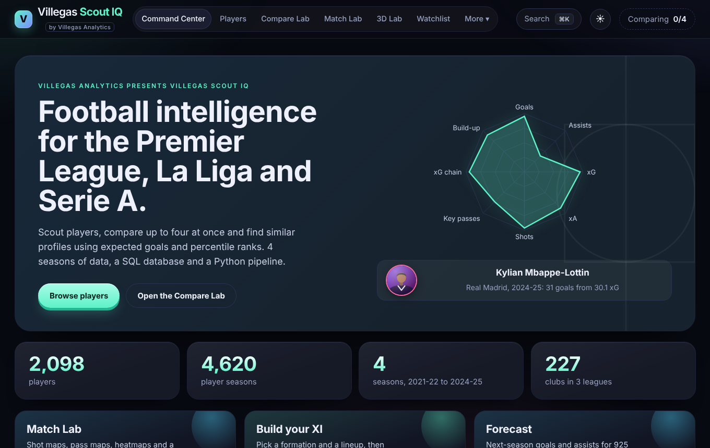
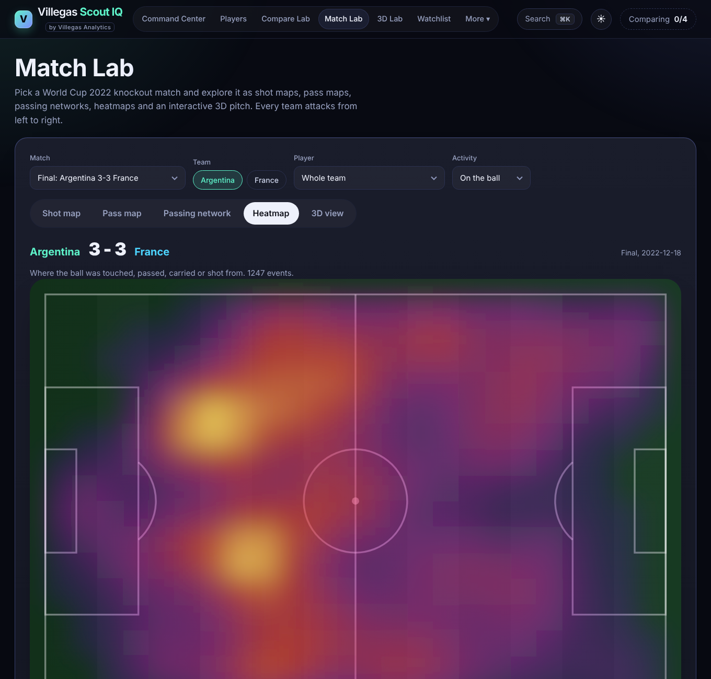

# Villegas Scout IQ

A football scouting site I built for my Information Systems degree. You can search about 2,000 players from the Premier League, La Liga and Serie A, compare up to four at once, look for similar players, and explore real match data on a 3D pitch.

Made by Juan Villegas, Villegas Analytics.



## What's in it

**Player scouting** (four seasons, 2021-22 to 2024-25)
- Players table with filters, a star to save players to a watchlist, and a button to add them to a comparison.
- Compare Lab: up to four players side by side with a radar chart, a head-to-head table and per-90 bars. The comparison lives in the page link, so you can send it to someone.
- Player pages with percentile bars, a downloadable player card, a printable scouting report and a list of similar players.
- Play Styles: players grouped into styles (like "Playmaker" or "Goal threat") by a clustering model, shown on a 2D map.
- 3D Lab: every player as a point in 3D space. You pick the three measures for the axes and fly around.
- Team of the Season, Season Awards, Breakout Finder, Replacement Finder, Scorers Race and a Build Your XI page.
- Forecast: projected goals and assists per 90 for next season, with a test that shows how well the model does.
- A search box that understands simple questions like "creative midfielders in La Liga". It is built from rules, not an AI model.

**Match Lab** (2022 World Cup knockout games)
- Shot map, pass map, passing network and heatmap for any team or player.
- A 3D pitch with heat towers, pass arcs and a shot replay that freezes the other players where they stood.



## How it fits together

```
Understat numbers (via a public GitHub copy)
   scripts/import_github_players.py   download
   scripts/build_dataset.py           clean up, work out positions and percentiles
   scripts/build_clusters.py          group players into play styles
   scripts/build_forecast.py          train and test the forecast model
   scripts/build_database.py          load everything into a SQLite database
                |
                v
   frontend/src/data/*.json           what the website reads
   data/scoutiq.db                    the database, used by the API and the SQL examples

StatsBomb Open Data
   scripts/build_matches.py           download and shrink the match files
                |
                v
   frontend/public/statsbomb/*.json   what Match Lab reads

frontend/   the website (React, Vite, Recharts, three.js)
backend/    a small read-only API on top of the database (FastAPI)
```

The website doesn't need a server. The build scripts make JSON files and the browser reads them directly. The database and API are a second, more traditional way to get at the same data.

The full explanation is in [docs/HOW_IT_WORKS.md](docs/HOW_IT_WORKS.md). If you want the short version for talking about the project, see [docs/INTERVIEW_NOTES.md](docs/INTERVIEW_NOTES.md).

## Run it yourself

You need Python 3.10 or newer and Node 20 or newer.

```bash
# 1. Build the data (from the project folder)
pip install pandas numpy requests
python scripts/import_github_players.py
python scripts/build_dataset.py
python scripts/build_clusters.py
python scripts/build_forecast.py
python scripts/build_database.py
python scripts/build_matches.py       # only if you want to re-download the match data

# 2. Start the website
cd frontend
npm install
npm run dev                           # then open the address it prints

# 3. Run the tests
npm test                              # in frontend/
pip install pytest httpx fastapi      # then, from the project folder:
pytest backend

# 4. Optional: start the API
pip install -r backend/requirements.txt
uvicorn backend.main:app --reload     # docs at http://127.0.0.1:8000/docs
```

The processed data files are already in the repo, so steps 1 can be skipped if you only want to look at the site.

## Things I'd tell you up front

- The player numbers come from Understat, through a public copy on GitHub, because Understat's own site was down when I built this. It covers 2021-22 to 2024-25 only.
- There are no goalkeepers, ages, nationalities or transfer values in that data, so the site can't answer questions about those.
- Team standings aren't included for the same reason. The Teams page and one SQL example stay empty until I can download team data.
- Match Lab uses a different data source (StatsBomb) and only covers 16 World Cup games. It isn't connected to the player data.
- The forecast is simple on purpose. It is better than guessing "same as last season", but it knows nothing about injuries or transfers.
- Player pictures are drawn by code from the player's name and club. They are not photos.

## Data and credit

- Player statistics: [Understat](https://understat.com). I used a third-party copy of their data. Check Understat's terms before reusing the numbers.
- Match data: [StatsBomb Open Data](https://github.com/statsbomb/open-data), FIFA World Cup 2022. Please credit StatsBomb if you show it, and read their open data agreement.
- The code is MIT licensed (see LICENSE). That does not cover the data.

## Tools used

React, Vite, React Router, Recharts, three.js with react-three-fiber, Vitest, Python (pandas, NumPy), SQLite, FastAPI, GitHub Actions.
